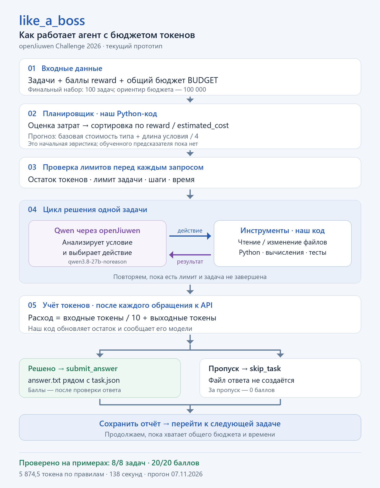

# like_a_boss — краткая сводка проекта

Репозиторий: https://github.com/verrronikka/like-a-boss-openjiuwen

## Суть соревнования

Нужно разработать агента на **openJiuwen**, который получает 100 задач и общий бюджет токенов и набирает максимум баллов. Есть четыре типа задач: математика, поиск по локальным файлам, анализ CSV и исправление Python-кода. Награда `reward` известна заранее. Часть финальных задач невыполнима при имеющихся данных; за пропуск баллы не начисляются.

Бюджет передаётся через `BUDGET`; ориентир организаторов — 100 000 в эквиваленте выходных токенов.

## Что реализовано

- Python-harness: загрузка задач, выбор порядка, цикл «модель → инструмент → результат» и ограничения на расход, шаги и время.
- Интеграция с openJiuwen и API NeuralDeep. В проверенном запуске использована **qwen3.8-27b-noreason**; одна модель на весь запуск.
- Инструменты чтения и записи файлов, запуска Python, сдачи ответа и пропуска задачи.
- Сохранение `answer.txt` рядом с `task.json` и отдельного отчёта о расходе. При пропуске ответ не создаётся.
- Dockerfile, зафиксированные версии зависимостей, отдельная локальная проверялка и 12 автоматических тестов.

**Qwen решает задачи. Наш код выбирает задачи, выполняет инструменты и управляет бюджетом.** Веса Qwen не изменялись; модель не дообучалась. История диалога создаётся заново для каждой задачи. Эталонные ответы используются только отдельной локальной проверялкой, не передаются модели и не включены в образ агента.

## Использованные математические методы

### 1. Эвристическая оценка будущих затрат

`estimated_cost = base_cost[task_type] + floor(len(instruction) / 4)`

Начальные значения `base_cost`: поиск — 350, математика — 450, анализ данных — 700, код — 1800. Длина измеряется в символах. Это условная оценка для сортировки, а не точный подсчёт токенов и не обученная модель.

### 2. Жадное ранжирование по выгоде

`priority = reward / estimated_cost`

Задачи выполняются по убыванию приоритета. Это простая эвристика для распределения ограниченного ресурса; она не гарантирует оптимальный набор задач.

### 3. Взвешенный учёт фактического расхода

`spent = input_tokens / 10 + output_tokens`

`remaining = max(0, BUDGET - spent)`

Числа берутся из статистики API после каждого запроса. Рассуждения входят в выходные токены и повторно не прибавляются. Кеш не уменьшает учитываемый входной расход.

### 4. Ограничение следующего запроса

Перед вызовом модели код приблизительно резервирует расход на вход и ограничивает максимальный выход остатком общего бюджета и лимита задачи. Этот резерв приблизительный; он не гарантирует точного предсказания полного решения.

## Проверенный результат

Настоящий прогон 7 ноября 2026 через API NeuralDeep:

| Показатель | Результат |
| --- | --- |
| Открытые примеры | 8 из 8 решены |
| Локальная оценка | 20 из 20 баллов |
| Вход / выход | 40 045 / 1 870 токенов |
| Расход по правилам | 5 874,5 |
| Время | 138 секунд |

Обе задачи на код прошли тесты; исходные тесты не изменялись. Параметры прогона: `--budget 20000 --task-budget 4000 --max-steps 12 --max-output 2048 --time-limit 600`. Это результат на открытых примерах, а не оценка скрытых 100 задач.

## Что дальше

Собрать собственные задачи разной сложности, включая невыполнимые; измерить реальные затраты; откалибровать прогноз и правила остановки; сравнить четыре разрешённые модели и выбрать одну для финального запуска. Регрессия или бустинг могут стать следующим способом прогнозирования, **сейчас они не используются**. Окончательная команда запуска и порядок сдачи уточняются у организаторов.

## Схема

